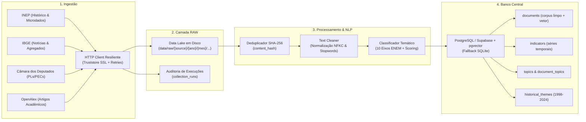

# Arquitetura do Sistema — ENEM Predictor Pipeline

Este documento detalha o desenho arquitetural, os princípios de engenharia de dados e os fluxos de informação implementados no pipeline do ENEM Predictor.

---

## 1. Visão Geral da Arquitetura

O sistema foi concebido sob o padrão de **Pipeline Modular e Rastreável**, dividindo responsabilidades entre ingestão controlada, camada imutável de dados brutos (Data Lake RAW), camada de validação e normalização, classificação temática e camada de persistência estruturada relacional/vetorial.

---

## 2. Responsabilidades dos Módulos

| Módulo | Caminho | Responsabilidade Primária |
| :--- | :--- | :--- |
| **Configuração** | `enem_pipeline.config` | Gerenciamento de variáveis de ambiente com Pydantic Settings e resolução de diretórios |
| **Banco & Modelos** | `enem_pipeline.db` | Modelagem declarativa SQLAlchemy, migrations Alembic e suporte dual PostgreSQL/pgvector e SQLite |
| **Coletores** | `enem_pipeline.collectors` | Conexão com APIs oficiais, retries com backoff exponencial, timeout e rate limit |
| **Camada RAW** | `enem_pipeline.storage.raw_store` | Persistência física imutável de payloads brutos em disco particionado por data |
| **Processamento** | `enem_pipeline.processing.cleaner` | Higienização de HTML, normalização de caracteres e extração de termos-chave |
| **Classificador** | `enem_pipeline.processing.classifier` | Classificação multi-eixo com vocabulário semântico ponderado dos 10 eixos do ENEM |
| **Interface CLI** | `enem_pipeline.cli` | Terminal interativo com Typer e tabelas analíticas em Rich |
| **Agendador** | `enem_pipeline.scheduler` | Orquestração periódica via APScheduler com jobs configurados |

---

## 3. Decisões Arquiteturais Fundamentadas (ADRs)

### ADR 01: Armazenamento RAW Híbrido (Disco + Banco)
- **Contexto:** Necessidade de preservar dados brutos íntegros sem inflar desnecessariamente o banco relacional e garantir que o payload original possa ser reprocessado caso os modelos de NLP mudem.
- **Decisão:** O payload original bruto é gravado como arquivo JSON imutável em `data/raw/{source}/{ano}/{mes}/{dia}/` e sua cópia textual indexada é mantida na tabela `documents` com hash SHA-256 único.
- **Consequência:** Rastreabilidade completa e auditoria forense dos dados sem complexidade operacional de storages proprietários.

### ADR 02: Deduplicação Criptográfica por Hash SHA-256
- **Contexto:** As APIs de notícias, proposições e artigos são consultadas periodicamente e frequentemente retornam itens já ingeridos em execuções anteriores.
- **Decisão:** Calcular `content_hash = sha256(conteudo)` antes da inserção. Se o hash já existir no banco ou no lote da sessão em memória, o registro é contabilizado como duplicata rejeitada e descartado da inserção.
- **Consequência:** Zero duplicação de dados, redução de I/O no banco e total integridade de séries temporais.

### ADR 03: Compatibilidade Dual PostgreSQL + pgvector e SQLite
- **Contexto:** O projeto exige PostgreSQL e pgvector para busca semântica em nuvem (Supabase), mas o ambiente do desenvolvedor ou pipelines de CI/CD podem não dispor de um servidor Postgres local em execução imediata.
- **Decisão:** Implementação de `CompatibleVector` TypeDecorator e controle de conexão via `DATABASE_URL`. Quando apontado para Supabase, habilita a extensão `vector` e campos `vector(1536)`. Quando sem Postgres, roda em SQLite local (`enem_pipeline.db`) permitindo testes rápidos e desenvolvimento autônomo.
- **Consequência:** Máxima portabilidade sem sacrificar o poder analítico vetorial em produção.

### ADR 04: Tratamento Nativo de Certificados SSL no Windows
- **Contexto:** Python no Windows frequentemente falha com `CERTIFICATE_VERIFY_FAILED` ao acessar portais governamentais brasileiros (Câmara, INEP) devido a autoridades certificadoras intermediárias da ICP-Brasil.
- **Decisão:** Injeção de `truststore.inject_into_ssl()` nos coletores e sessões do pipeline.
- **Consequência:** Resolução transparente e automática dos certificados sem necessidade de desativar verificação de SSL (`verify=False`).
