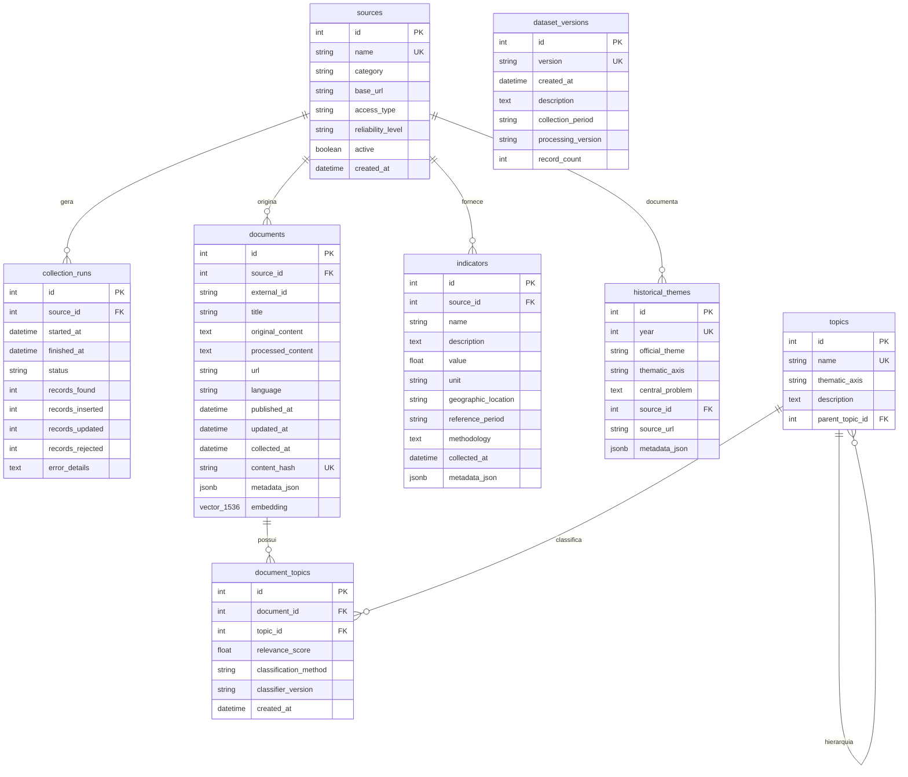

# Dicionário de Dados — ENEM Predictor

Este documento descreve detalhadamente o modelo de dados relacional e vetorial implementado para o pipeline de aquisição e armazenamento do ENEM Predictor.

---

## 1. Diagrama de Relacionamento de Entidades (ERD)

---

## 2. Detalhamento dos Campos e Tabelas

### 2.1. Tabela: `sources`
Cadastro mestre das fontes provedoras de dados.
- `id` (INTEGER, PK): Identificador sequencial.
- `name` (VARCHAR(100), UNIQUE, NOT NULL): Código único da fonte (`inep`, `ibge`, `camara`, `openalex`, `ipea`, `gdelt`, `google_trends`).
- `category` (VARCHAR(50), NOT NULL): Categoria (`education`, `statistics`, `legislative`, `academic`, `news`).
- `base_url` (VARCHAR(500), NOT NULL): URL base da instituição/API.
- `access_type` (VARCHAR(50), NOT NULL): Tipo de conexão (`api_rest`, `structured_json`, `odata`, `scraping`).
- `reliability_level` (VARCHAR(20), DEFAULT 'high'): Grau de autoridade (`high`, `medium`, `low`).
- `active` (BOOLEAN, DEFAULT TRUE): Indica se o coletor está habilitado.
- `created_at` (TIMESTAMP): Registro de criação da fonte.

### 2.2. Tabela: `collection_runs`
Log auditável de execuções de coleta (ETL monitoring).
- `id` (INTEGER, PK): Identificador da execução.
- `source_id` (INTEGER, FK -> `sources.id`): Fonte executada.
- `started_at` (TIMESTAMP, NOT NULL): Timestamp de início.
- `finished_at` (TIMESTAMP, NULL): Timestamp de término.
- `status` (VARCHAR(30)): Estado da execução (`running`, `success`, `partial`, `failed`).
- `records_found` (INTEGER): Total de itens recebidos no payload.
- `records_inserted` (INTEGER): Novos registros inseridos.
- `records_updated` (INTEGER): Registros atualizados.
- `records_rejected` (INTEGER): Registros rejeitados (inválidos ou duplicados).
- `error_details` (TEXT): Rastreio de exceções ou logs de erro.

### 2.3. Tabela: `documents`
Corpus textual coletado e normalizado para alimentação de NLP e Embeddings.
- `id` (INTEGER, PK): Identificador único.
- `source_id` (INTEGER, FK -> `sources.id`): Identificador da fonte de origem.
- `external_id` (VARCHAR(255)): Identificador único no sistema de origem (ex: ID da proposição na Câmara, DOI ou Work ID no OpenAlex).
- `title` (VARCHAR(1000)): Título do documento ou ementa da matéria.
- `original_content` (TEXT, NOT NULL): Texto bruto ou payload íntegro coletado.
- `processed_content` (TEXT): Conteúdo textual limpo, normalizado e sem tags espúrias.
- `url` (VARCHAR(1000)): Link oficial do documento.
- `language` (VARCHAR(10), DEFAULT 'pt'): Código ISO do idioma.
- `published_at` (TIMESTAMP): Data oficial de publicação original.
- `updated_at` (TIMESTAMP): Data de última alteração na origem.
- `collected_at` (TIMESTAMP, NOT NULL): Data e horário da ingestão pelo pipeline.
- `content_hash` (VARCHAR(64), UNIQUE, NOT NULL): Hash criptográfico SHA-256 para garantia de unicidade e deduplicação estrita.
- `metadata_json` (JSONB / JSON): Metadados estruturados complementares.
- `embedding` (VECTOR(1536) / JSON): Vetor de embedding denso para busca semântica futura via `pgvector`.

### 2.4. Tabela: `indicators`
Indicadores quantitativos, demográficos e séries temporais.
- `id` (INTEGER, PK): Identificador do indicador.
- `source_id` (INTEGER, FK -> `sources.id`): Fonte provedora (ex: IBGE, IPEA).
- `name` (VARCHAR(255), NOT NULL): Nome do indicador (ex: "Taxa de analfabetismo funcional", "População estimada").
- `description` (TEXT): Descrição conceitual do indicador.
- `value` (DOUBLE PRECISION, NOT NULL): Valor numérico apurado.
- `unit` (VARCHAR(50), NOT NULL): Unidade de medida (ex: `%`, `habitantes`, `R$`, `índice de 0 a 1`).
- `geographic_location` (VARCHAR(100), DEFAULT 'Brasil'): Abrangência geográfica (Brasil, UF ou Município).
- `reference_period` (VARCHAR(50)): Ano ou período temporal ao qual o valor se refere.
- `methodology` (TEXT): Metodologia ou notas técnicas da pesquisa.
- `collected_at` (TIMESTAMP, NOT NULL): Data da coleta.
- `metadata_json` (JSONB / JSON): Propriedades técnicas da série.

### 2.5. Tabela: `topics`
Taxonomia dos eixos temáticos do ENEM e problemas sociais específicos.
- `id` (INTEGER, PK): Identificador do tópico.
- `name` (VARCHAR(100), UNIQUE, NOT NULL): Nome do tema (ex: "Educação", "Inteligência Artificial e Mercado de Trabalho").
- `thematic_axis` (VARCHAR(100), NOT NULL): Eixo macro oficial (ex: "Educação", "Tecnologia", "Direitos Humanos e Cidadania").
- `description` (TEXT, NOT NULL): Descrição do eixo e escopo temático.
- `parent_topic_id` (INTEGER, FK -> `topics.id`, NULL): Auto-relacionamento para hierarquia de subtemas.

### 2.6. Tabela: `document_topics`
Classificação temática de documentos em $N:N$.
- `id` (INTEGER, PK): Identificador da classificação.
- `document_id` (INTEGER, FK -> `documents.id`): Documento classificado.
- `topic_id` (INTEGER, FK -> `topics.id`): Eixo temático associado.
- `relevance_score` (DOUBLE PRECISION): Grau de pertinência/confiança (0.0 a 1.0).
- `classification_method` (VARCHAR(50)): Método aplicado (`lexical_rules_v1`, `bert_pt_v1`, etc.).
- `classifier_version` (VARCHAR(20)): Versão do algoritmo classificador.
- `created_at` (TIMESTAMP): Data em que a classificação foi realizada.

### 2.7. Tabela: `historical_themes`
Base histórica oficial de temas de redação do ENEM (1998–2024).
- `id` (INTEGER, PK): Identificador do registro.
- `year` (INTEGER, UNIQUE, NOT NULL): Ano de aplicação do exame.
- `official_theme` (VARCHAR(500), NOT NULL): Frase tema oficial proposta aos candidatos.
- `thematic_axis` (VARCHAR(100), NOT NULL): Eixo temático principal no qual o tema se enquadra.
- `central_problem` (TEXT, NOT NULL): O problema social, ético ou cultural central exigido na proposta de intervenção.
- `source_id` (INTEGER, FK -> `sources.id`): Fonte da prova (INEP).
- `source_url` (VARCHAR(500)): Link oficial para o caderno de prova / espelho.
- `metadata_json` (JSONB / JSON): Informações complementares (ex: se houve 2ª aplicação, PPL, etc.).

### 2.8. Tabela: `dataset_versions`
Versionamento de snapshots de dados preparados para treinamento de modelos de IA.
- `id` (INTEGER, PK): Identificador do snapshot.
- `version` (VARCHAR(50), UNIQUE, NOT NULL): Tag da versão (ex: `v2026.1-train`).
- `created_at` (TIMESTAMP): Data de geração do dataset.
- `description` (TEXT): Finalidade e escopo do conjunto de dados.
- `collection_period` (VARCHAR(100)): Janela temporal abrangida pelos dados coletados.
- `processing_version` (VARCHAR(50)): Versão do pipeline de pré-processamento utilizado.
- `record_count` (INTEGER): Quantidade de documentos/indicadores compilados no dataset.
